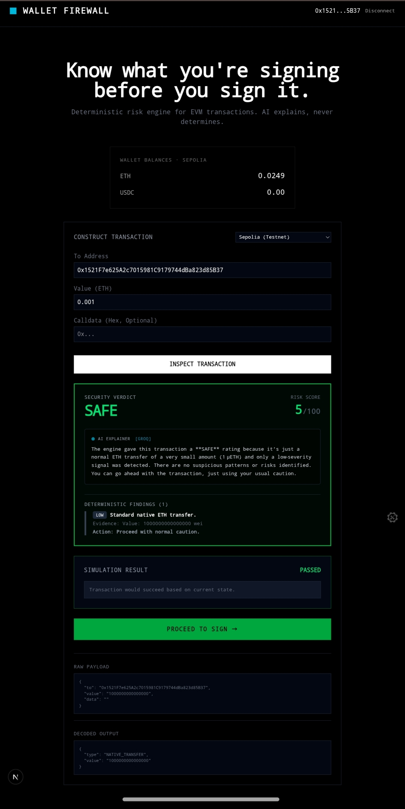
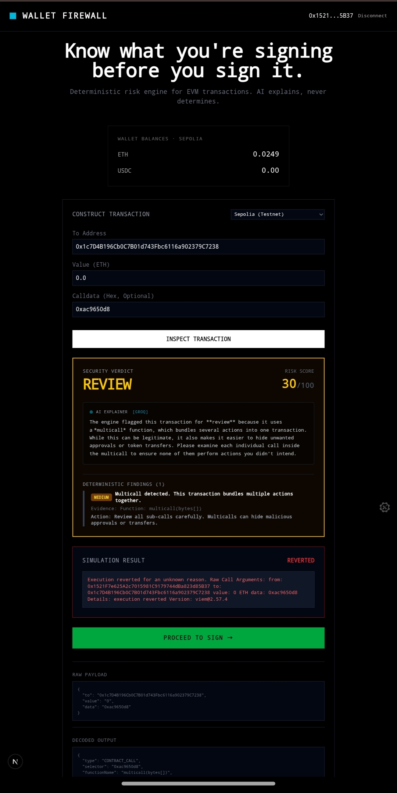
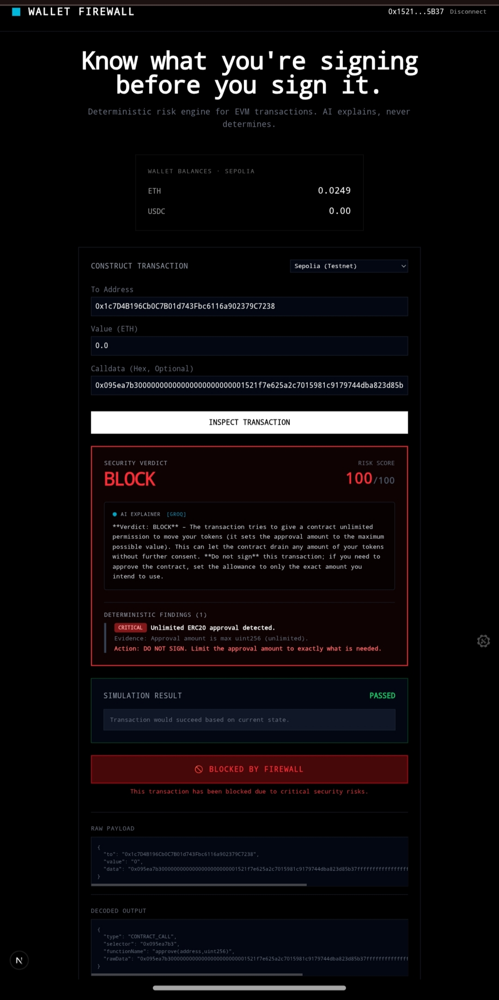
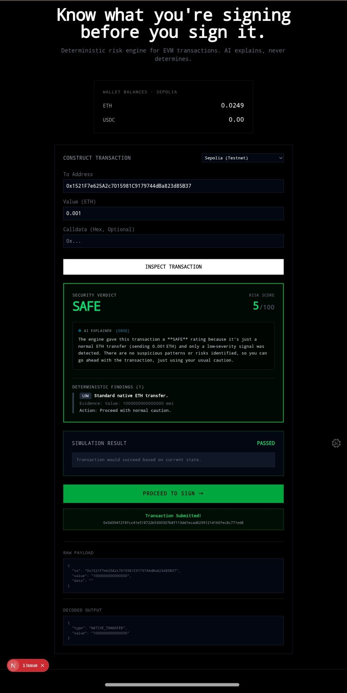

# 🧱 Wallet Firewall

> **Know what you're signing before you sign it.**

A deterministic security layer that analyzes EVM transactions **before** the user signs them. Decodes, simulates, scores, and explains — with a verdict of **SAFE**, **REVIEW**, or **BLOCK**.

---

## What It Does

| Stage | Description |
| :--- | :--- |
| **Decode** | Extracts function selectors and maps them to signatures |
| **Intel** | Fetches bytecode, balance, nonce of the target address |
| **Simulate** | Runs `eth_call` to catch reverts before signing |
| **Score** | Deterministic risk engine (0-100) with hard blocks |
| **Explain** | LLM translates findings to plain English (never overrides verdict) |
| **Gate** | Disables the sign button when verdict is BLOCK |

---

## Screenshots

*Standard ETH transfer — scored SAFE (5/100).*

*Multicall detected — scored REVIEW (30/100).*

*Unlimited ERC20 approval — hard blocked (100/100).*

*ERC20 approval — flagged for review.*

## Architecture

    Wallet -> Transaction -> Decoder -> Contract Intel -> Simulation
       -> Asset/Permission Analysis -> Deterministic Risk Engine
       -> AI Explanation -> SAFE / REVIEW / BLOCK

---

## The Risk Engine

**HARD BLOCKS** (force BLOCK, non-negotiable):

- Calldata sent to an EOA (externally owned account)
- Unlimited ERC20 approval (`uint256.max`)

**SCORE SIGNALS** (weighted 0-100):

- Unknown selector: +40
- ERC20 approval: +25
- Multicall: +30
- Permit / Permit2: +50
- transferFrom: +50
- Native transfer: +5

**Verdict thresholds:**

- 0-29: SAFE
- 30-79: REVIEW
- 80-100 or hard block: BLOCK

---

## Stack

- **Frontend:** Next.js 16 (App Router, webpack), Tailwind v4, TypeScript
- **Web3:** wagmi v2, viem v2
- **AI:** Groq (openai/gpt-oss-120b) — explainer only
- **Chains:** Ethereum Sepolia (testnet) + Mainnet (read-only)

---

## Getting Started

### Prerequisites

- Node.js 20+
- A WalletConnect Project ID from cloud.walletconnect.com
- An Alchemy or Infura RPC URL for Sepolia + Mainnet
- A Groq API key from console.groq.com

### Install

    git clone git@github.com:YOUR_USERNAME/wallet-firewall.git
    cd wallet-firewall
    npm install

### Configure

    cp .env.example .env.local

Edit `.env.local` and fill in your keys.

### Run

    npm run dev

Visit `http://localhost:3000`

---

## Non-Negotiable Constraints

- Never store private keys server-side
- Never sign transactions server-side
- LLM cannot influence the risk score — only explain it
- Fail-safe, never fail-open: if the analyzer crashes, it does NOT report "safe"

---

## Roadmap

- [x] Wallet connection (Injected + WalletConnect)
- [x] Native + ERC20 balance reads
- [x] Transaction construction UI
- [x] Decoder (selector -> signature)
- [x] Contract intelligence
- [x] Deterministic risk engine
- [x] eth_call simulation
- [x] Unlimited approval detection
- [x] Security UI with gated signing
- [x] AI explanation layer
- [x] Multicall + Permit/Permit2 decoding
- [x] Mainnet read-only support
- [x] Live signing via useSendTransaction
- [ ] Browser extension
- [ ] Embeddable SDK
- [ ] Contract reputation database (Supabase)
- [ ] Multi-chain support (Arbitrum, Base, Polygon)

---

## Test Cases

**Safe native transfer:**

    To: 0x1521F7e625A2c7015981C9179744dBa823d85B37
    Value: 0.01 ETH
    Result: SAFE (5/100)

**Unlimited approval:**

    To: 0x1c7D4B196Cb0C7B01d743Fbc6116a902379C7238 (USDC)
    Calldata: 0x095ea7b3...ffffffff...ff
    Result: BLOCK (100/100)

**Multicall:**

    Calldata: 0xac9650d8
    Result: REVIEW (30/100)

---

## License

MIT

